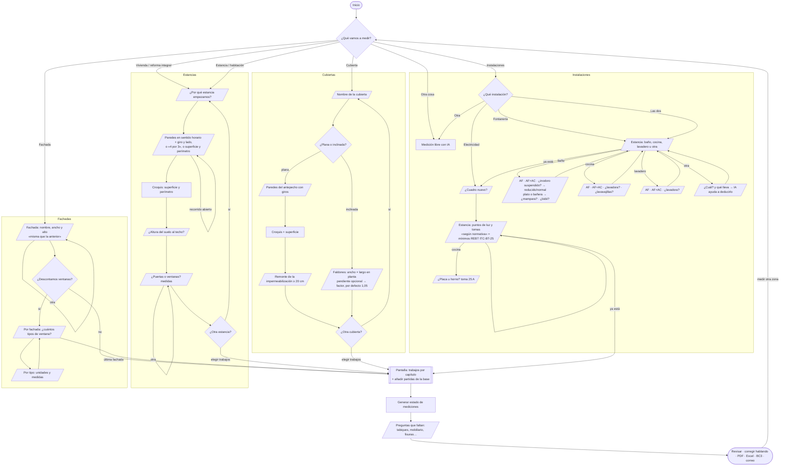

# Flujo de la medición guiada

Versión implementada del diagrama de flujo (19/11/2026). Primero se toman las medidas y después se eligen en la pantalla los trabajos. Con los trabajos elegidos, la app genera el estado de mediciones.

## Si no entiende una respuesta (nunca se queda atascado)
1. Si la frase se cortó por una pausa («rectangular de 3 por…»), espera al resto («Sigue, te escucho») y une los dos trozos. También prueba a juntar una respuesta fallida con la siguiente.
2. Si puede adivinar lo que quería decir, lo confirma en vez de repetir la pregunta: «¿Quieres decir una planta rectangular de 3 por 3?» (planta, altura, huecos, fachadas, faldones).
3. Primer fallo: vuelve a preguntar con otras palabras y un ejemplo, con el botón «Volver atrás».
4. Segundo fallo: consulta a la IA, que reescribe la respuesta en el formato de la pregunta.
5. Tercer fallo: ofrece volver al paso anterior, saltar el dato o probar otra vez.
6. Cuarto fallo: vuelve solo al paso anterior («Para no atascarnos, volvemos al paso anterior») y quita la estancia que se había empezado sin medidas.
7. Para corregir basta con decir «me he equivocado», «eso está mal», «atrás»… o pulsar «↩ Atrás», que está siempre visible. Primero deshace lo último anotado en la misma pregunta (la última puerta, pared, fachada o faldón); si no hay nada, vuelve a la pregunta anterior y dice qué ha quitado.
8. **Correcciones al dictar:** si en la misma frase se corrige una medida («0,82 por 2,30, no, perdón, 2,03», «dos sesenta… digo dos setenta», «12 por 7, no, 8 de alto»), la app no anota nada y pregunta cuál de las dos versiones oídas es la correcta (botones o «la primera / la segunda / la medida»). Si la corrección llega en la frase siguiente («no, era 2,10»), compara lo anotado con lo nuevo y pregunta igual; solo cambia lo anotado si se elige la nueva.
   Lo mismo con palabras: «sí, una puerta, digo una ventana», «plana, perdón, inclinada», «plato de ducha, no, bañera», «la cocina, digo el baño», «derecha, perdón, izquierda». Si oye «digo», «perdón», «quiero decir»… y no sabe qué parte se corrige, no anota nada y pide repetirlo.
   Correcciones de algo dicho antes: «las ventanas de antes son puertas» cambia el tipo de los huecos anotados; si la corrección es más liosa («en realidad la ventana era de 1,40 de alto y había otra puerta igual»), la IA rehace los datos de la estancia con la conversación y la app propone el resultado completo antes de cambiar nada.
   Huecos: «una puerta de 80, una de 90 y una ventana de 60x90» (la que no dice tipo hereda el anterior; puerta sin alto = 2,03; ventana sin alto: se pregunta).
9. Lo que interpreta la IA y los nombres de estancia poco habituales se confirman antes de aplicarse: el asistente nunca sigue por su cuenta con algo que no se ha dicho.
10. En cualquier momento: «atrás», «ayuda», «repite», «saltar», «cancela» (medición libre), «borra el pasillo», «añade armario empotrado en el dormitorio».

## Reglas de medición
| Regla | Cálculo |
|---|---|
| Suelo / techo | superficie de la planta |
| Paredes | perímetro × altura − huecos (puertas y ventanas) |
| Rodapié | perímetro − anchos de puerta |
| Fachada | ancho × alto − ventanas (si se descuentan) |
| Sellado de carpinterías | perímetro de cada tipo de ventana × unidades |
| Vierteaguas | ancho de cada tipo de ventana × unidades |
| Cubierta plana | superficie; impermeabilización + perímetro × remonte (≥ 0,20 m) |
| Cubierta inclinada | Σ faldones ancho × largo × factor de pendiente |
| Desagües | Ø32 lavabo y bidé · Ø40 ducha, bañera, fregadero, lavadero, lavadora y lavavajillas · Ø110 inodoro (CTE DB HS 5, tabla 4.1) |
| Electricidad «según normativa» | REBT ITC-BT-25, electrificación básica, con la superficie medida de la estancia |
| Lavadora / lavavajillas | se registran en fontanería y pasan a electricidad como tomas de 16 A con toma de tierra |

## Incidencias fuera del guion
En cualquier momento (también con el asistente terminado) el usuario puede describir a su manera una patología que ve, y la app la recoge sin perder el hilo:

| Lo que dice (ejemplos) | Pregunta | Partidas (desglosado / una sola) |
|---|---|---|
| «este pilar tiene los hierros oxidados», «se cae el hormigón del pilar» | ¿Cuántos pilares así? · metros a reparar en cada uno | Picado · cepillado de armaduras · pasivado · mortero de reparación / Reparación de pilar completa — **por metro lineal** |
| «la viga tiene las armaduras al aire» | ¿Cuántas vigas? · metros de cada una | Igual / Reparación de viga completa — **por metro lineal** |
| «cantos de forjado desconchados» | metros · canto del forjado | Igual, sobre el frente / Reparación de canto de forjado (m) |
| «el techo/muro tiene hierros oxidados» | superficie | Igual / Reparación de superficie de hormigón armado |
| «sube la humedad por el muro», «salitre» | metros de muro · altura a tratar | Picado del revestimiento · barrera química por inyección · mortero de saneamiento / Tratamiento de humedad por capilaridad (m) |
| «hay grietas en el muro» | metros de fisura | Apertura · sellado / Limpieza y cosido de grietas |

La primera vez pregunta si se quiere **desglosado por fases** o **en una sola partida** y lo recuerda para la obra. Las líneas llevan la estancia o zona donde se estaba midiendo y, al terminar, el asistente vuelve a la pregunta en curso.

## Partidas generales de toda obra
Se añaden solas a cualquier estado de mediciones (se pueden desmarcar en la pantalla de trabajos):
- **Gestión de residuos:** contenedores de 4,2 m³. La app los estima con las demoliciones medidas (volumen esponjado ×1,3) y al generar pregunta «¿lo dejo así o cuántos pongo?».
- **Seguridad y salud:** partida alzada al 2 % del PEM por defecto; se cambia diciendo «seguridad y salud al 3 por ciento».

## Modo breve
En Ajustes («Modo breve») o por voz («modo breve» / «modo completo»). Las preguntas quedan en lo esencial («¿Qué medimos?», «¿Altura del salón?», «¿Puertas o ventanas? Con medidas, o "ninguna"»), sin ejemplos ni explicaciones, y el micro se abre antes. Al terminar una medición se ofrece el botón «Modo breve».

## Humedades
Se pregunta la causa (capilaridad, condensación o filtración) salvo que se diga en la frase, y se puede cambiar diciéndolo en cualquier momento. Condensación: limpieza con fungicida y pintura antimoho (m²). Filtración: picado, impermeabilización con mortero impermeable y enfoscado (m²). Capilaridad: como antes (metros de muro y altura). Si la frase trae la superficie («unos dos metros cuadrados»), no se vuelve a preguntar.
